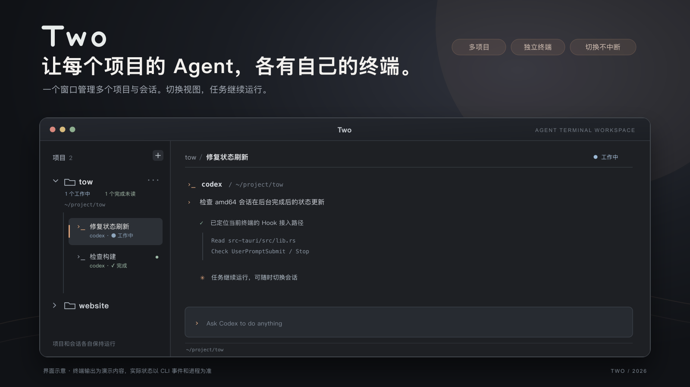

# Two



*界面示意。项目、会话及终端输出用于展示布局，实际内容由用户运行的 CLI 决定。*

Two 是轻量的多项目 Agent 终端工作台：按“项目目录 → 终端会话”组织独立终端。**切换会话或收起项目不会结束进程。**

本文面向本地试用与开发者，描述 v0.1.1 的用法和验证范围。功能与验收口径见 [PRD.md](PRD.md)，当前进度见 [ROADMAP.md](ROADMAP.md)。

## 核心能力

- **项目归属清楚**：使用系统目录选择器添加项目，新会话始终在所属目录启动。
- **终端独立运行**：每个会话是独立的系统登录终端；用户自行运行 `codex`、`agy` 等命令，切换时保留进程、输出和输入草稿。
- **状态有可信依据**：普通终端显示进程状态；收到 Codex 的任务事件后，侧栏才显示工作中或完成。

## 当前交付范围

| 平台 | 当前情况 |
| --- | --- |
| macOS arm64 | v0.1.0 已构建；用户确认退格显示及 Codex 前台、后台完成状态自动更新。v0.1.1 尚未在 arm64 复测。 |
| macOS x64 | v0.1.1 Release `.app` 已在 x86_64 主机构建；用户已在采用相同修复代码的前一构建中确认 Codex 后台状态自动刷新。v0.1.1 包及其他交互仍待逐项验收。 |
| Windows 11 x64、Ubuntu 24.04 x64 | 已准备构建入口，尚未完成对应系统的打包和运行验收。 |

安装包尚未签名、公证或经过干净环境安装测试。构建成功不等于完整的平台验收。

## 本地运行与构建

开发需要 Node.js、npm、Rust 工具链及 [Tauri 2 平台前置依赖](https://v2.tauri.app/start/prerequisites/)。按需安装并登录要使用的 Agent CLI。在项目根目录运行：

```sh
npm ci
npm run tauri -- dev
```

单独运行 `npm run dev` 只能查看布局；普通浏览器无法创建项目或终端。安装 GNU Make 后，在目标系统运行 `make app` 构建当前架构的 Release 应用。

| 指定命令 | 产物 |
| --- | --- |
| `make mac-arm64` | `src-tauri/target/aarch64-apple-darwin/release/bundle/macos/Two.app` |
| `make mac-amd64` | `src-tauri/target/x86_64-apple-darwin/release/bundle/macos/Two.app` |
| `make windows` | `src-tauri/target/x86_64-pc-windows-msvc/release/bundle/nsis/*.exe` |
| `make linux` | `src-tauri/target/x86_64-unknown-linux-gnu/release/bundle/deb/*.deb` |

macOS 可跨架构构建，但须先安装对应 Rust target，例如 `rustup target add x86_64-apple-darwin`。Windows 和 Linux 目标需在各自系统上构建。

项目目录、内部包名和应用数据标识沿用 `agent-workspace`，以保留现有配置。本次本地构建使用项目忽略目录 `.tmp/` 下的 Rust 工具链；运行应用不依赖它。

## 日常使用

1. 点击侧栏“项目”旁的加号，通过系统目录选择器添加项目。
2. 点击项目行“···”旁的加号，在该项目目录新建终端，然后自行输入 `codex`、`agy` 等命令。
3. 单击会话切换；项目折叠和会话切换只改变显示，不结束后台进程。
4. 右击会话行或点击当前会话右上角“···”，可重命名、重启已退出会话或删除会话。

删除运行中的会话会结束其中的程序。删除项目只移除 Two 的记录和所管理的会话，**不会删除磁盘目录或文件**；仍有运行中的终端或未结束任务时不能直接删除项目。

关闭 Two 会结束本应用管理的终端进程；存在运行中的终端或任务时先提示确认。重启后只恢复项目和会话定义，不恢复终端全文，也不自动启动旧进程。配置位于系统应用数据目录的 `workspace.json`。

### Codex 状态与命名

Two 中通过包内脚本启动的 Codex 使用独立 app-server，并为该进程传入 `UserPromptSubmit` 和 `Stop` Hook。提交事件驱动工作状态和首条任务命名；只有匹配任务 ID 的完成事件才显示“完成”。OSC 终端状态只用于工作／空闲提示。

新包不要求其他机器预先安装全局 Codex Hook。首次运行若提示 Hook 待审核，请输入 `/hooks`，核对指向 Two 包内 helper 的命令后信任；未信任的 Hook 会被跳过。使用绝对路径或自定义 alias 绕开包内脚本时，任务状态可能不可用。

独立 app-server 的启动和内存开销尚未测量。Codex 提供本地记录路径时，Two 会按任务 ID 读取结构化完成记录作为延迟 Hook 的兜底；该记录格式不是稳定公开接口。agy 目前只接入任务命名，其他 Agent 缺少可信事件时只显示终端进程状态。

Two 保留 CLI 原始界面。Codex 在输入框有草稿时自行隐藏 `for agents · ? for shortcuts` 提示。

## 开发检查

```sh
npm run build
node --test tests/pty-input.test.mjs tests/pty-resize.test.mjs tests/terminal-signals.test.mjs
cargo test --manifest-path src-tauri/Cargo.toml --lib
cargo test --manifest-path src-tauri/Cargo.toml --bin agent-workspace
```

输入与尺寸队列测试覆盖快速按键、退格、窗口缩放和会话关闭；Rust 测试覆盖事件乱序、旧会话兼容、保存失败回滚、PTY 工作目录、shell 输入及 Codex 启动参数。测试和构建不能替代真实桌面交互或跨平台验收。

## 文档与设计

- [PRD.md](PRD.md)：功能规则、界面边界与验收场景。
- [ROADMAP.md](ROADMAP.md)：实施进度和验证记录。
- [AGENTS.md](AGENTS.md)：项目协作及实现约束。
- [design/concept.html](design/concept.html)：可交互原型，浏览器打开即可查看；使用模拟输出，不连接真实 CLI。
- [design/readme-hero.svg](design/readme-hero.svg)：本页宣传图的可编辑源文件。

正式桌面版使用 Tauri 2、TypeScript、HTML／CSS、xterm.js 和 Rust。PTY 由 `portable-pty 0.9.0` 管理，输出经 Tauri Channel 传给界面；子进程设置 `TERM=xterm-256color`，xterm 使用默认 DOM 渲染。
